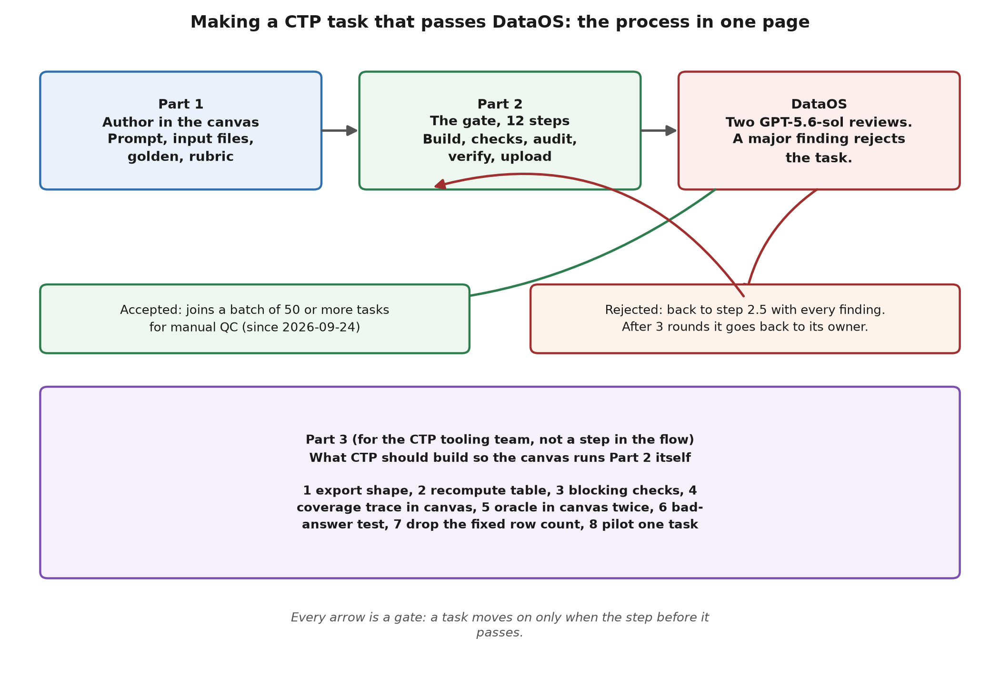
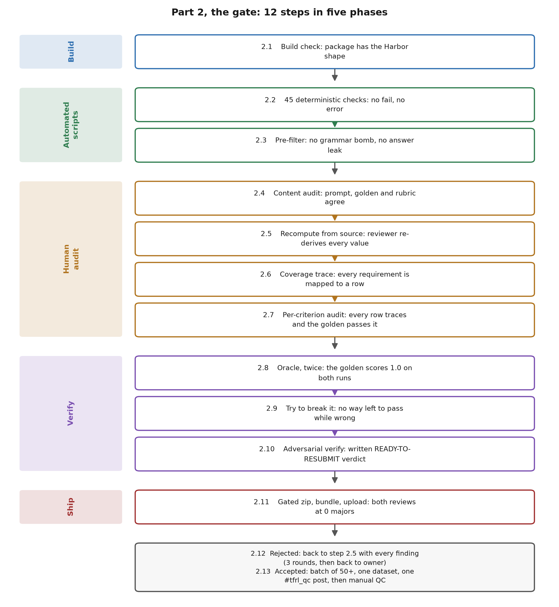

# Making a CTP task that passes DataOS: the full process

Khiem Doan, 2026-09-28. For trainers building tasks in the CTP canvas (https://task.turing.com) and for the CTP
tooling team.

DataOS is the grader that decides whether a task is accepted: https://data-os.turing.com



## At a glance (one page)

**Trainer, in the canvas (Part 1).** This is your whole job. Tick each box before you submit.

- [ ] 1.0 Open the task ("L3 Authoring", label to confirm) and read the whole persona and scenario.
- [ ] 1.1 Prompt: one gradable ask per sentence; names the output file, its format and its sections; no hints
  or expected values.
- [ ] 1.2 Input files: every file the task needs, including every file a rubric row checks; nothing else.
- [ ] 1.3 Recompute: every expected value worked out from the input files yourself, with its source.
- [ ] 1.4 Golden (your own complete, correct answer): matches the recomputed values, under 1 MB per file.
- [ ] 1.5 Scoring Form: one row per fact, carrying the recomputed value and quoting the prompt words it checks;
  no rows the prompt didn't ask for.
- [ ] 1.6 Run rubric: the golden gets full points on every single row (not 90 of 100; ignore the Final Status
  badge).
- [ ] 1.7 QC Readiness: every flagged item fixed, nothing bypassed.
- [ ] 1.8 Submit for QC, then send the task ID to Khiem Doan.

**Package builder, the gate (Part 2).** Today Khiem Doan's team runs this for CTP tasks. A CTP developer can
run 2.1 to 2.10 after the setup in "Before you start". Every step must pass before the next one.

1. 2.1 Build the package from the canvas files and check its shape.
2. 2.2 45 scripted checks: structure and leaks, rubric and mechanics, golden health. No fail or error.
3. 2.3 Pre-filter: no group over 15 rows, no missing graded file, no answer leak. Read the pre-submit report.
4. 2.4 Content audit: prompt, golden and rubric state the same facts.
5. 2.5 Recompute from source by a reviewer; fix the whole class of any gap.
6. 2.6 Coverage trace: every prompt requirement maps to a row.
7. 2.7 Per-row audit: every row passes the task failure checklist, and the golden passes it strictly.
8. 2.8 Oracle: the golden scores 1.0, twice.
9. 2.9 Try to break it: a wrong answer fails; on a resubmission, the regrade passes.
10. 2.10 Adversarial verify: a written READY-TO-RESUBMIT verdict.
11. 2.11 Gated zip, upload, run "ManualQC automated QC pipeline 4 Reviewers" (version 9 on 2026-10-14; DataOS pipeline 141, version 9 is spec 533).
    Fail = any of the four Answer Check reviews reports a major. (Needs a DataOS project assignment for CTP
    tasks, see Questions to settle #2.)
12. 2.12 Rejected: back to 2.5 with every finding. (Same DataOS dependency as 2.11.)
13. 2.13 Accepted: your manager reviews it, then it joins a manual-QC batch of 50 or more. (Batch owner for CTP not set, see Questions #6.)

The rest of this doc explains each step, the command or file that runs it, and its pass rule.

## What this guide is

Every task we have shipped to DataOS went through the same gate: author it, then run it through our full
check-and-verify process, then upload. This guide is that process, applied to tasks made in CTP.

- **Part 1, authoring in the canvas.** What the trainer does in Phase 1 and Phase 2 so the task can clear
  the gate. No code, no repo access.
- **Part 2, the gate.** Every check and verification we actually run, in order, with the command, what it
  catches and the pass rule. No task goes to DataOS until it clears all of Part 2. It follows section 6a of
  the team SOP (`docs/QC-SOP-first-run.md`, updated 2026-09-28).
- **Part 3, what CTP should build** so the canvas runs Part 2 itself.

Part 2 runs on a Harbor task package (the folder shape DataOS grades: `instruction.md`, `task.toml`,
`environment/`, `solution/`, `tests/`), because that is what DataOS grades and what our scripts read. The
canvas can't export that shape yet (Part 3, change 1), so step 2.1 builds it by hand from the canvas files.

**Who runs Part 2 today.** Until CTP and we settle Questions 2 and 3 below, Khiem Doan's team runs 2.1 to
2.13 for CTP tasks. A trainer's job ends at Submit (1.8) unless a rejection comes back. A CTP developer who
wants to run the gate directly can: "Before you start" lists everything needed, and 2.1 to 2.10 run on a
laptop. The upload (2.11 onward) needs DataOS access and a project decision first.

**What this does and doesn't promise.** Clearing Part 2 removes every defect we can catch before DataOS
sees the task. It does not guarantee a pass. The final call is made by the reviews in the DataOS pipeline, and
their severity calls on coverage and over-grading can't be fully predicted locally. Clearing Part 2 does not
predict the DataOS result or the TFRL QC call (TFRL is the human QC team that samples each batch, see 2.13). The rates the team reported earlier were measured under the older
pipelines, are early and unaudited, and are not quoted here. A rejection goes back through Part 2 (step 2.12).
DataOS is the only verdict.

An older copy of this guide sits in the team repo at `docs/ctp-task-guide.md`. This version replaces it.
Its two figures are separate files in an `images/` folder next to this guide (`images/process-overview.png`
and `images/part2-gate.png`), linked by relative path. Copy that folder along with the guide, for example to
`docs/images/` beside `docs/ctp-task-guide.md`, or the figures show as broken links.

### Terms used in this guide

| Term | Meaning |
|---|---|
| CTP canvas | The Central Task Platform web app at https://task.turing.com where trainers write tasks. |
| DataOS | Turing's grading platform at https://data-os.turing.com. Its pipeline accepts or rejects a task. |
| Golden | The complete, correct answer to the prompt, which you write yourself. Every row is tested against it. |
| Scoring Form, rubric | The list of pass/fail rows that grade an answer. In the canvas it is the Scoring Form workbook. |
| Row, criterion | One pass/fail check. The canvas says row; DataOS and the scripts say criterion. Same thing. |
| Group | The rows graded together in one grader call. After export, one group is one `tests/<group>/judge.toml` file. At most 15 rows per group. |
| Harbor package | The folder DataOS grades: `instruction.md` (the prompt), `task.toml`, `environment/` (input files), `solution/` (golden), `tests/` (rubric). |
| `reward.toml`, `judge.toml` | The rubric files in `tests/`. `reward.toml` weights the groups; each `judge.toml` holds one group's rows, the grader model and the files the grader reads (`files=`). |
| Pinned grader | The exact grader DataOS runs: harbor-rewardkit 0.1.7 reading files through MarkItDown, judged by `claude-sonnet-4-6`. |
| Oracle | Grading the golden against its own rubric. It must score 1.0. |
| Grammar bomb | A group with more than 15 rows. DataOS's grader errors ("compiled grammar is too large") and scores the whole task 0, golden included. |
| Answer-key leak | An expected value or a grader file the model under test can see. |
| Comprehensive review | DataOS's GPT-5.6-sol review of the task. The retired "NO CLAUDE" pipeline ran two of these per run; the current pipeline (2.11) runs four Answer Check reviews instead, see the Answer Check row. Findings are major or minor; one major rejects. |
| Answer Check | One of the four identical reviews in the pipeline "ManualQC automated QC pipeline 4 Reviewers". Its review prompt is DataOS saved prompt 431, named Comprehensive_v3_pipeline_quality_re-derive_cascade_NOP_2026-10-03. A major in any one of the four rejects the task (2.11). |
| NOP | The empty-answer run: DataOS grades a submission with nothing in it, and it must score zero. |
| Review codes (1.1 to 1.8) | The categories a review files findings under. Table in 2.12. |
| Return zip | The file DataOS gives back after a run, named `<name>_with_runs.zip`. It holds the reviews, the models' answers and their scores. |
| Verify record | The text file the adversarial verify (2.10) writes. The zip builder (2.11) refuses a task without a current one. |
| `METHOD_VERSION` | The version stamp on line 1 of `svc-pc-pipeline/tools/svc_fix_method_rules.md` (`v8.1-2026-09-22-class-fix` on 2026-09-28). |

---

## Before you start

### Trainers (Part 1 only)

- An account on the CTP canvas, https://task.turing.com. If you can't sign in or can't see your task, ask the
  CTP tooling team (Archana, Manasvi Mohan Sharma, Parth Nayak) in Slack #central-task-platform-svc-feedback.
- Nothing else. You don't need the repo, Python or DataOS.
- Worked example used throughout Part 1: Claire's L2 sample, task SVC-PC-37-1-0. Its Scoring Form is on Drive
  (https://drive.google.com/file/d/1v1KeWyr_Wajf4qGy7DgoaY3HX-EasMHg/view); a copy is also in the team repo at
  `ctp-rubric-contract/samples/SVC-PC-37-1-0_L2_Child.xlsx` (branch `ctp-rubric-contract-2026-09-24`).

### Package builders (Part 2)

**1. Access to the team repo.** Everything Part 2 runs lives in `turing-genai-apps/EKW_QC_pipeline` on
GitHub, which is private. Being in the org's `ctp-eng` GitHub team does not grant it (on 2026-09-28, 8 of
that team's 10 members were not repo collaborators). Ask a repo admin to add you; on the CTP side,
Manasvi Mohan Sharma (`manasvi-turing`) and `ashutosh-turing` have admin rights on the repo. Or ask Khiem
Doan (khiem.doan@turing.com), who will route it.

**2. DataOS access (only for 2.11 to 2.13).** An account at https://data-os.turing.com on the team our SVC
tasks run under: the team tag under your name in the sidebar reads `Andrew_team` (label to confirm). Which
DataOS project CTP tasks should use is not decided (Questions #2). Ask Khiem Doan to route an access request.
Every pipeline run spends that team's shared credit, so don't run one without a change to test.

**3. Tools on your machine.**

- Python 3.12 or newer (harbor-rewardkit requires 3.12; our sandbox runs 3.13; the test run of this guide
  used 3.12.10).
- Git.
- The Claude Code CLI, installed and signed in with a Claude subscription seat. The LLM checks in 2.2, the
  oracle in 2.8 and 2.9, and the judgment steps 2.4 and 2.10 call it. No API key is used anywhere, and the
  oracle refuses any backend other than the CLI. If `claude` is not on your PATH (for example, the Windows
  desktop-app install, which keeps the CLI at `%APPDATA%\Claude\claude-code\<version>\claude.exe`), the
  variables block in step 6 sets `CLAUDE_CODE_BIN` to it for you. The Python scripts check that variable
  first, and every `claude` command in this guide is written as `"${CLAUDE_CODE_BIN:-claude}"`, so both
  use the same executable. If you set it by hand on Windows, use the `C:/Users/...` form with forward
  slashes, not Git Bash's `/c/Users/...` form: the scripts test the path with Windows Python, which can't
  see a `/c/...` path.
- A bash shell. Every command below is bash: Terminal on macOS or Linux, Git Bash on Windows. `python` means
  your Python 3.12 or newer (on macOS it may be `python3`).

**4. Get the code at the right refs.** Part 2 runs entirely from one branch, `svc-pc-pipeline-2026-09-23`: it
holds `deterministic-checks/`, `svc-pc-pipeline/tools/`, `docs/` and `pipeline/tools/`, everything on `main`
(PRs #70 and #71 merged it into `main` on 2026-09-28) plus a newer `svc_eval_regrade.py`. If that branch is
gone when you read this, it has been merged: use `main`. The converter and validator used in 2.1 and Part 3
live only on `ctp-rubric-contract-2026-09-24`, so check that branch out alongside, as a second worktree.

```bash
# core.autocrlf=false keeps LF line endings on Windows, so shell scripts still run in DataOS's Linux container
git clone -c core.autocrlf=false https://github.com/turing-genai-apps/EKW_QC_pipeline.git
cd EKW_QC_pipeline
git checkout svc-pc-pipeline-2026-09-23
git worktree add ../EKW_QC_ctp ctp-rubric-contract-2026-09-24
```

**5. Install the Python packages** (from inside `EKW_QC_pipeline`):

```bash
python -m venv .venv
source .venv/bin/activate          # Windows Git Bash: source .venv/Scripts/activate
pip install "harbor-rewardkit[documents]==0.2.0" openpyxl python-docx pypdf numpy
```

`harbor-rewardkit[documents]` brings the MarkItDown file reader the oracle needs; without the
`[documents]` part, spreadsheets and Word files reach the grader unread. Optional but recommended: a second
environment with the exact loader DataOS runs at upload (rewardkit 0.1.7), so 2.11's Gate 1b can run instead
of being skipped.

```bash
python -m venv .venv017
.venv017/bin/pip install "harbor-rewardkit==0.1.7"      # Windows Git Bash: .venv017/Scripts/pip install "harbor-rewardkit==0.1.7"
```

**6. Set the working variables.** Every command in Part 2 uses these, so you can paste the commands as they
are. Run this block from inside `EKW_QC_pipeline`, in every new shell. `here` prints a path the Windows
Python can read when you are in Git Bash, and a normal path everywhere else.

```bash
source .venv/bin/activate                               # Windows Git Bash: source .venv/Scripts/activate
here() { pwd -W 2>/dev/null || pwd; }
export REPO="$(here)"                                   # this checkout (svc-pc-pipeline-2026-09-23)
export SVC_REWARDKIT017_PY="$REPO/.venv017/bin/python"  # only if you made .venv017; Windows: "$REPO/.venv017/Scripts/python.exe"
export CTP="$(cd ../EKW_QC_ctp && here)"                # the ctp-rubric-contract-2026-09-24 worktree
export BASE="$(cd ~ && here)/ctp-qc"
export TASKS="$BASE/tasks"        # one subfolder per task, named exactly by task ID
export RESULTS="$BASE/results"    # check output and your judgment-step files
export RECORDS="$BASE/records"    # verify and regrade records the zip builder reads
export TASK=SVC-PC-37-1-0         # your task ID
export QC_JUDGE_EMULATE_SCRATCH="$BASE/scratch/judge_emulate_app"   # the oracle's working copy
export PYTHONUTF8=1               # Python reads and writes UTF-8 on every platform (see below)
# If `claude` is not on PATH (Windows desktop-app install), use the app's bundled Claude Code CLI:
if [ -z "$CLAUDE_CODE_BIN" ] && ! command -v claude >/dev/null; then export CLAUDE_CODE_BIN="$(ls -d "$(cygpath -m "$APPDATA" 2>/dev/null)"/Claude/claude-code/*/claude.exe 2>/dev/null | sort -V | tail -1)"; fi
echo "claude CLI: ${CLAUDE_CODE_BIN:-$(command -v claude)}"
mkdir -p "$TASKS" "$RESULTS" "$RECORDS/returns" "$BASE/scratch"
```

Keep `$RESULTS` and `$RECORDS` outside the package folder: anything inside `$TASKS/$TASK` gets zipped and
uploaded. `QC_JUDGE_EMULATE_SCRATCH` matters: without it the oracle writes under `/root/qc/`, a sandbox
path that a normal account can't create on macOS or Linux.

`PYTHONUTF8=1` matters on Windows. Without it, Windows Python writes redirected output (`> file`) in the
cp1252 code page instead of UTF-8, so any character outside that code page in a prompt is corrupted in
files the scripts write, and 2.6 can crash on the corrupted text instead of reporting. On macOS and Linux
with the usual UTF-8 locale it has no effect. The `claude CLI:` line should print a path; if it prints
nothing, the Claude Code CLI isn't installed or isn't where step 3 says, so fix that before Part 2.

On Windows, keep `$BASE` short (the default `~/ctp-qc` is fine). Windows Python can't see a file whose full
path is longer than about 260 characters, and the scripts then report the file missing (for example, the pre-filter says
"no tests/deliverables*/judge.toml found") rather than raising an error. Deep input-file paths under a long
`$BASE` can cross that limit.

**7. Check the setup.**

```bash
python -c "import rewardkit, markitdown, openpyxl; print('python packages OK')"
python "$CTP/ctp-rubric-contract/tools/check_rubric_package.py" "$CTP/ctp-rubric-contract/example/SVC-PC-12-6-0"
echo "Reply with the word OK" | "${CLAUDE_CODE_BIN:-claude}" -p
```

The second command should print the summary line `HARD: 0  WARN: 5` (the accepted example's recorded
result) followed by five `[WARN]` lines, and the third should print OK. "command not found" on the third
means step 6's `claude CLI:` line printed nothing: see step 3.

**8. Collect the task's files from the trainer.** You need five things: the task ID, the final prompt text
from Phase 1, the Scoring Form workbook, the golden file or files, and the input files. The trainer has the
Scoring Form and golden because they uploaded them in Phase 2. The input files are the corpus files listed
in the Scoring Form's Input Manifest sheet, at the paths shown there; copy them from the task's corpus
folder. Whether the canvas can download any of these directly is not confirmed (Questions #8).

---

## Part 1. Authoring in the canvas

The canvas takes you through its steps in this order: Phase 1, Phase 2, Run rubric, QC Readiness, Submit for
QC Review (names as the CTP team describes them; exact on-screen labels to confirm).

### 1.0 Open the task

Click "L3 Authoring" (label to confirm; it replaced an earlier "Claim a task" button in July), or open the L2
task you were assigned. Read the whole persona and scenario before writing anything.

### 1.1 Phase 1: write the prompt

- One gradable ask per sentence. "Reconcile the trial balance to the P&L" is gradable. "Establish the
  foundation" is not.
- Name the output file, its format, and any required tabs or sections. Use a format the grader can read:
  `.xlsx` (not `.xlsm`), `.docx`, `.pptx`, `.pdf`, or plain text such as `.md` or `.csv`.
- State the as-of date when timing matters, and anything the answer must not do.
- Never put an expected value or a hint about the answer in the prompt.

Example: Claire's L2 sample (SVC-PC-37-1-0) expects `Tax_Basis_and_Book_to_Tax_Workpaper.xlsx` with six
sections, but the prompt names neither the file nor the sections. DataOS reviewers flag that as ambiguity
(review code 1.3), and the model under test can't produce what it was never told about.

### 1.2 Phase 1: pick the input files

- Every file the task needs, and nothing else.
- Every file a rubric row checks must be here; the grader only reads attached files. (Claire's F15 checks
  titles against "the employee roster", which isn't among the six input files, so no answer can pass it.)
- Open each file and confirm it reads correctly.

### 1.3 Recompute every expected value from the input files

For every fact the prompt asks for, open the input files and work the value out yourself, with its source
(file, tab, cell or section). Never copy it from the golden. This list becomes the rubric's expected values
and the golden's numbers.

Example, Claire's L2 sample, worked out from its six input files:

| Prompt asks for | Value from the input files | Source |
|---|---|---|
| Book P&L | Revenue $1,204,900, COGS $423,359, OpEx $1,446,874, net loss $665,333 | `Year_1_Annual_PnL.xlsx`, FY2021 column |
| Trial balance ties | Debits = credits = $4,279,744 | `Year_End_Trial_Balance.xlsx`, Pre-Close TB |
| Accumulated deficit vs book loss | $665,333; opening retained earnings $0 | same file, Closing Entry and Post-Close TB |
| Year-end adjustments | 4 entries, $50,879 (prepaid $1,333, returns reserve $702, fulfillment accrual $30,000, inventory $18,844) | `Year_End_Adjusting_Entries.xlsx` |
| Fixed assets | $0 depreciation, no fixed assets | `Fixed_Asset_Depreciation.xlsx`, Dashboard |
| Items needing the CPA | $14,000 unredeemed gift cards; $2,000 returns reserve | trial balance accounts 2300 and 2400 |

The sample rubric checks only the first row.

### 1.4 Phase 2: build the golden

The golden is the complete, correct answer to the prompt. You write it yourself, and every row is tested
against it.

- Every number matches 1.3. Show the arithmetic where the prompt asks for a calculation.
- Save it under the exact filename the prompt names.
- Keep each golden file under 1 MB. The grader silently skips a file over 1 MB, and every row that needs it
  scores 0.
- For a workbook, open it in Excel and save it, so every formula cell carries a stored value. The grader
  reads stored values; a formula that was never calculated reads as blank.

### 1.5 Phase 2: write the rubric (Scoring Form)

The Scoring Form has these columns: Criterion ID, Lens (Form/Content), Criterion Description, Expected value
or value range, Points, Must-Pass Gate (Yes/No), Tolerance or review rule, Points Score, Must-Pass Gate
Result, Final Status. Each row scores its full points or zero; there is no partial credit.

- One row per fact from 1.3, carrying the recomputed value in Expected value ("Reports FY2021 revenue of
  $1,204,900").
- One fact per row. Split bundled rows like Claire's C01 (four figures) into four.
- Every row quotes the prompt words it checks. A row with no prompt line behind it isn't graded.
- Form rows only for what the prompt states (file name, sections). Generic rules the prompt never asks
  for ("uses five status labels", "every open item names an owner") are the 1.4 findings that fail tasks.
- If a fact is optional, word the row so skipping it passes ("If the workpaper states depreciation, it
  is $0").
- No "X or Y" expected values and no blanket tolerance paragraph. Anything you write in Tolerance or review
  rule is copied into the row the grader reads, so keep it to that row's own fact.
- Must-Pass Gate = Yes only for a fact that must be true for the task to be usable at all. DataOS has no
  gates: to DataOS every row must pass, gate or not.
- Groups: after export, each group of at most 15 rows becomes one `judge.toml` file (see Terms). The canvas
  has no groups yet; our converter (2.1) splits your rows by Lens into groups of at most 15. You don't need
  to do anything for this, but a long Content section becomes several groups.

### 1.6 Run rubric

Upload the golden and click Run rubric (label to confirm). Then open the Scoring Form result and confirm that
every single row's Points Score is its full Points value.

- The canvas's own Final Status (Pass / Pass with Open Items / Blocked) uses a 90-of-100-points-plus-gates
  rule. Ignore that badge: DataOS needs every row to pass, not 90 of 100.
- Run rubric grades with Claude Haiku 4.5. DataOS's rubric grader is `claude-sonnet-4-6` and its reviewers
  are GPT-5.6-sol, so a pass in Run rubric is a floor, not a promise that DataOS agrees.

### 1.7 QC Readiness

The canvas runs automated checks here and can flag items. Our last record of this screen lists four LLM
checks: persona supported by the corpus, leakage, golden addresses the prompt, golden claims supported
(list to confirm against the live screen). Fix every flagged item instead of clicking Bypass: bypassing one
sends a known problem to DataOS.

### 1.8 Submit for QC, then hand off

Click Submit for QC (label to confirm; the CTP team calls this step "Submit for QC Review"). Then send Khiem
Doan the task ID on Slack (#central-task-platform-svc-feedback, or a direct message). Until Questions 2 and 3
are settled, that message is the hand-off: Khiem's team collects the files and runs Part 2. Your job is done
unless a rejection comes back (2.12), in which case you get every finding and fix the task in the canvas.

---

## Part 2. The gate: every check and verification, in order

Every command below uses the variables from "Before you start", step 6. Scripts come from the team repo,
branch `svc-pc-pipeline-2026-09-23`, except the converter and validator in 2.1, which come from
`ctp-rubric-contract-2026-09-24`. They were built on SVC tasks; they run on a CTP package once 2.1 has built
it. For tasks in our own lane queue, the lane runner (`svc-pc-pipeline/tools/svc_v7_lane_runner.sh`) does 2.5
to 2.11 automatically; this section is the same gate done by hand.

Any edit to the package sends you back: re-run 2.2, 2.3 and 2.6 on the changed package, and run 2.8 to 2.11
in order on the final files. The zip builder in 2.11 enforces the last part: it refuses a verify or regrade
record older than the newest edit.



### 2.1 Build the package, then check its shape (B)

CTP has no export yet, so build the Harbor package by hand. The result must look like this, with
`$TASKS/$TASK` as the task folder:

```
$TASKS/$TASK/
  instruction.md                      the Phase 1 prompt, plus the graded filename section
  task.toml                           task settings, copied from the accepted example
  environment/Dockerfile              the container DataOS builds
  environment/initial_workspace/...   every input file, at its Input Manifest path
  solution/solve.sh                   copies the golden into place for the oracle run
  solution/files/<output filename>    the golden
  tests/reward.toml                   group weights
  tests/deliverables_NN/judge.toml    one per group, at most 15 criteria each
  tests/test.sh                       the grading script, copied from the accepted example
  tests/task_prompt.txt               a copy of instruction.md
```

1. Convert the Scoring Form into `tests/`, then rename the groups. The converter names groups `form_01`,
   `content_01` and so on, but our pre-filter and several of the 45 checks only look in
   `tests/deliverables*/`: with the converter's names, the pre-filter stops at "HARD: no
   tests/deliverables*/judge.toml found". The rename below fixes the folder names and `reward.toml` together.

   ```bash
   mkdir -p "$TASKS/$TASK/environment/initial_workspace" "$TASKS/$TASK/solution/files"
   python "$CTP/ctp-rubric-contract/tools/scoring_form_to_harbor.py" "<path to Scoring Form.xlsx>" "$TASKS/$TASK"
   python - "$TASKS/$TASK/tests" <<'EOF'
   import sys, re, pathlib
   t = pathlib.Path(sys.argv[1])
   groups = sorted(p.parent.name for p in t.glob("*/judge.toml"))
   new = {g: "deliverables_%02d" % (i + 1) for i, g in enumerate(groups)}
   for g, n in new.items():
       (t / g).rename(t / n)
   r = (t / "reward.toml").read_text(encoding="utf-8")
   for g, n in new.items():
       r = re.sub(r"\b%s\b" % re.escape(g), n, r)
   (t / "reward.toml").write_text(r, encoding="utf-8", newline="\n")
   print(new)
   EOF
   ```

2. Copy the harness files from the accepted example task (SVC-PC-12-6-0, which DataOS accepted):

   ```bash
   EX="$CTP/ctp-rubric-contract/example/SVC-PC-12-6-0"
   cp "$EX/task.toml" "$TASKS/$TASK/task.toml"
   cp "$EX/tests/test.sh" "$TASKS/$TASK/tests/test.sh"
   printf '#!/bin/bash\nset -euo pipefail\nmkdir -p /app\ncp -a /solution/files/. /app/\n' > "$TASKS/$TASK/solution/solve.sh"
   python -c "import sys; sys.path.insert(0, sys.argv[1]); import to_rewardkit as t; open(sys.argv[2], 'w', newline='\n').write(t.DOCKERFILE)" "$REPO/pipeline/tools" "$TASKS/$TASK/environment/Dockerfile"
   ```

   The checked-in example is rubric-only by design: it holds `instruction.md`, `task.toml` and `tests/`,
   with no `environment/` and no `solution/`. Use it for `check_rubric_package.py` (as in "Before you
   start", step 7) and as the source of `task.toml` and `tests/test.sh`, as above. Don't run the pre-filter
   or the 45 checks against it: with no input or golden files there is nothing for them to check the rubric
   against. The pre-filter, for example, reports `HARD: deliverables_01: files= names Compliance_Memo.docx
   (not in package)` for each of its three groups. That means the files were never checked in, not that
   the example is broken. (The Dockerfile comes from `pipeline/tools/to_rewardkit.py`, not from the example.)

   Then open `task.toml` and edit the `[task]` name (for example `name = "svc/svc-pc-37-1-0"`) and the
   `[metadata]` lines (domain, occupation, sector, subdomain, task_type, tags) to describe your task. Leave
   the other sections as they are.

3. Write `instruction.md`: paste the Phase 1 prompt exactly, then add this section at the end, listing each
   graded output file. Then copy it to `tests/task_prompt.txt`.

   ```
   ## Graded deliverable filenames

   Submit the graded deliverables using these exact filenames (and paths where shown):

   - `Tax_Basis_and_Book_to_Tax_Workpaper.xlsx`
   ```

   ```bash
   cp "$TASKS/$TASK/instruction.md" "$TASKS/$TASK/tests/task_prompt.txt"
   ```

4. Put each input file under `environment/initial_workspace/` at the exact relative path the grader will look
   for. The converter wrote those paths into every `files=` line; print them with:

   ```bash
   grep -h '^files' "$TASKS/$TASK"/tests/*/judge.toml | head -1
   ```

   Each `/app/<path>` entry is either an input file, which goes at `environment/initial_workspace/<path>`, or
   the output file, which goes at `solution/files/<path>`. For Claire's sample that means, for example,
   `environment/initial_workspace/Company Shared Drive/Finance/2021/Annual/Year_1_Annual_PnL.xlsx`.

5. Put the golden at `solution/files/<output filename>`, the exact name the prompt and the `files=` line use.
   Convert an `.xlsm` golden to `.xlsx` first, and keep each file under 1 MB.

6. Run the validator from the CTP branch:

   ```bash
   python "$CTP/ctp-rubric-contract/tools/check_rubric_package.py" "$TASKS/$TASK"
   ```

The converter does a straight export: it copies each row's Tolerance and Evaluation Guidance text into the
criterion, including release-rule wording such as "total score is at least 90". You remove that wording in
2.7; it means nothing to DataOS.

**Pass rule:** the folder matches the tree above, and the validator prints `HARD: 0`. A WARN is read and
either fixed or noted (it flags compound rows and generic form checks, which 2.7 fixes).

### 2.2 Deterministic checks, C, D and E (45 scripts)

Run them all in one command (about 3 minutes for one task):

```bash
python "$REPO/deterministic-checks/svc_run_checks.py" "$TASK" --root "$TASKS" --out-dir "$RESULTS/checks"
```

`--root` is the PARENT folder that holds one subfolder per task, named exactly by task ID (the native shape,
e.g. `03_dataos_ready/<TASK-ID>/`); it is not the package folder itself. With the variables above that is
`$TASKS`, and the package is `$TASKS/$TASK`. Point `--root` at the package itself and the runner exits with
"no task directories found under <root>". It writes `$RESULTS/checks/summary.csv`, one row per task with a
verdict per check, plus one JSON file per check with the details.

- **C, structure and leaks (8):** `deliverable_count`, `environment_input`, `environment_size_budget`,
  `answer_key_leakage`, `answer_key_content_leak`, `answer_key_rubric_leak`, `metadata_leak`,
  `structural_audit`. Catches: expected values or grader files the model under test can see, missing or
  placeholder inputs, oversized environments, internal metadata in files.
- **D, rubric and mechanics (31):** includes `instruction_requirement_coverage` and `test_coverage_absence`
  (prompt asks with no rubric row), `rubric_overspecification` and `criterion_groundedness` (rows grading
  things the prompt didn't ask for or the inputs don't support), `compound_criterion` (several facts in one
  row), `judge_scope_under_inclusion` / `judge_scope_over_inclusion` (the grader
  can't see a file a row needs, or sees far too much), `source_citation_existence` and
  `fabricated_unfilenamed_fact` (golden cites things that don't exist), `deliverable_filename`,
  `rubric_schema`, `weight_application`, `duplicate_criterion_content`, `pinned_value_prescreen`,
  `cell_address_pinned`, `undisclosed_terminology`, `spelling_grammar`, and the rest listed in `CHECKS` in the
  script.
- **E, golden and verifier health (6):** `golden_arithmetic` and `golden_groundedness` (the golden's numbers
  add up and come from the inputs; this is the scripted half of 1.3), `formula_health` and
  `formula_health_extraction_loss` (spreadsheet formulas carry values the grader can read),
  `source_truncation`, `verifier_executability`.

A few checks (`structural_audit`, `golden_groundedness`, `rubric_overspecification`,
`fabricated_unfilenamed_fact`, `judge_scope_under_inclusion`) call the Claude Code CLI; the rest are scripts.

**Pass rule:** no `fail` or `error` in any check. A `warn` is read and either fixed or noted.

### 2.3 Pre-filter and pre-submit report

```bash
python "$REPO/svc-pc-pipeline/tools/svc_prefilter.py" "$TASKS/$TASK"
```

Blocks (HARD): more than 15 rows in one group (the grammar bomb), a `files=` path with nothing behind it, an
answer-key leak, a `lease.json`, and no `tests/deliverables*/judge.toml` at all. Warns: garbled file names,
CRLF line endings (fix any CRLF warn on a `.sh` file: the container can't run it), leftover build files.

Then run the pre-submit report the SOP adds in section 6a:

```bash
python "$REPO/deterministic-checks/pre_submit_gate.py" --root "$TASKS/$TASK" --out "$RESULTS/$TASK.pre_submit.json"
```

It writes a JSON report and exits 1 on any fail. Read `layout_formula_advisory` first: its G, H and I warns
(a row pinned to the golden's sheet names or cells, a formula-count floor, formulas graded with no
recalculation) come from real rejections. Two of its parts, `harbor_rubric` and `reward_signal`, were built
for the EKW pipeline. On 2026-09-28 both reported fail on a local copy of an earlier revision of the example
task SVC-PC-12-6-0, for things SVC and CTP packages do by design: no canary line and no `/app/` paths in the
prompt, the standard `solve.sh` copy, no scripted check under `tests/`, no EKW decision ledger
(`reports/<task>_DECISIONS.json`) and no `judge_s2.toml`/`judge_s3.toml` samples. Treat their other findings
(for example a G2 phrase-pin candidate, which needs an EKW trace file to clear) as inputs to the 2.7 audit.

**Pass rule:** the pre-filter exits 0. In the pre-submit report, every `layout_formula_advisory` warn is fixed
or noted, and every `harbor_rubric` or `reward_signal` finding is either marked not applicable for the reason
above or carried into 2.7.

### 2.4 Content audit (A)

A person or an LLM reads the prompt, the golden and the rubric together and confirms they state the same
facts. The method is `deterministic-checks/content-audit/SKILL.md`: six defect patterns and a numbered
method. Its own status note says it was measured on a 50-task sample, not fully validated, so a clean result
is a strong first read, not a verdict. To run it with Claude Code:

```bash
cd "$TASKS/$TASK"
{ cat "$REPO/deterministic-checks/content-audit/SKILL.md"; printf '\n\nApply the method above to the task package in the current directory: instruction.md, the golden under solution/files/, and every tests/*/judge.toml. Report as its step 9 says: clean, defective (name the pattern and quote the text), or content_unavailable.\n'; } \
  | "${CLAUDE_CODE_BIN:-claude}" -p --permission-mode dontAsk --allowedTools "Read,Bash,Glob,Grep" > "$RESULTS/$TASK.content-audit.md"
cd "$REPO"
```

Without an agent, a person reads the six patterns in that file and checks each one by hand, writing the same
report to `$RESULTS/$TASK.content-audit.md`.

**Pass rule:** the report says clean, meaning no contradiction between the three. A defective finding is fixed
and the audit re-run.

### 2.5 Recompute from source (the coverage sweep)

The full version of 1.3, run by the reviewer, not the author. Rules R1 to R7 in
`svc-pc-pipeline/tools/svc_fix_method_rules.md` govern every fix. Write the result as a table in
`$RESULTS/$TASK.recompute.md`, one line per fact:
`fact the prompt asks for (quoted) | value from the inputs | source (file, tab, cell or section) | golden says | criterion that forces it | action`.

1. List every fact the prompt asks for.
2. Re-derive each value from the input files independently. If the golden disagrees, the golden is wrong
   (finding 1.1): fix the golden, never loosen the rubric to fit it.
3. Match each fact to the row that forces it. No row: add one. A row covering part of a set (10 of 24
   rows): extend it to the full set. A row accepting a wrong alternative: remove the alternative.
4. Fix the whole class, not one example (rule R2): if one refund is missing, check every refund.

**Pass rule:** every fact the prompt asks for is forced by a row carrying the recomputed value, and the table
shows it.

### 2.6 Coverage trace

```bash
python "$REPO/svc-pc-pipeline/tools/svc_coverage_trace.py" list "$TASKS/$TASK" > "$RESULTS/$TASK.coverage.tsv"
```

`list` splits the prompt into numbered requirement units (R01, R02, ...), one per line:
`<id>\t<hash>\t<requirement text>`, with `#` comment lines at the top. Edit that file into the map: keep the
id and hash, and replace the third column (the requirement text) with the criterion names that grade the unit,
comma-separated, exactly as they appear in `name =` in the `judge.toml` files (e.g. `C01,C04`). Add a fourth
column for a note. The `<hash>` lets `check` tell whether `instruction.md` changed after the map was written.
A `-` in the criterion-names column means "not a gradeable requirement" and needs a note starting
`NOT-A-REQUIREMENT:`; a `-` on a must/required/should sentence is still allowed with that note, and prints as
EXEMPT rather than failing. A unit marked `[STRONG]` that no criterion grades is a coverage gap: add a row,
don't exempt it. Edit the map in a text editor, not Excel, keep the columns tab-separated, and save it as
UTF-8. Then:

```bash
python "$REPO/svc-pc-pipeline/tools/svc_coverage_trace.py" check "$TASKS/$TASK" "$RESULTS/$TASK.coverage.tsv"
```

A Python traceback ending in `UnicodeEncodeError` (which also exits 1) is not an uncovered requirement: it
means `list` ran without `PYTHONUTF8=1`, so non-ASCII characters in the prompt were corrupted in the map
file. Run step 6's block, run `list` again and redo the map from the new file.

**Pass rule:** exit 0 (clean). Exit 1 means at least one `UNCOVERED:` line (a requirement no criterion
grades); exit 2 means only `MALFORMED:` lines (map errors). When both kinds appear it exits 1, so fix every
line it prints, not just the first kind.

### 2.7 Per-criterion audit

Every row in every group is checked, not only rows a finding named (rules R4, R5). Work through
`docs/task-failure-checklist.md` for every criterion and write one line per criterion to
`$RESULTS/$TASK.criterion-audit.md`: criterion id, then Q1 to Q4 answered yes or no with the prompt line or
source cell, then whether the golden passes it on a strict reading.

- Q1: does the prompt ask for this? If not, remove or loosen the row, or add the ask to the prompt (1.4).
- Q2: does it accept every answer the sources support?
- Q3: does the expected value re-derive from the sources?
- Q4: does the prompt forbid or restrict it?
- Does the golden pass it on a strict reading, including any locator, stored value or citation it demands?
- Can DataOS's pinned grader actually read what it checks (rule R6)?

Then Q5 for the golden as a whole: every citation, case, date, approval and result the golden states must be
stated in a named input file, or come out. In the same pass, delete the converter's leftover release-rule
wording from each criterion (2.1).

**Pass rule:** every criterion has a line, and every answer is yes. Every "no" is a fix, whatever the row's
weight: change the row or the prompt, then re-answer. Don't rate a "no" as minor; in a blind test on
2026-09-28 our reviewers found the exact rows QC later rejected and rated them minor.

### 2.8 Oracle, twice

`judge_emulate.py` grades the golden with the rubric the way DataOS does (same file reader, same grader
framing), using the Claude Code CLI. `--runs 2` makes two independent runs; `total_reward` is the lower of
the two, and `flips` lists any criterion that passed in one run and failed in the other.

```bash
python "$REPO/svc-pc-pipeline/tools/judge_emulate.py" oracle "$TASK" --corpus-root "$TASKS" --runs 2 --out "$RESULTS/$TASK.oracle.json"
python -c "import json, sys; d = json.load(open(sys.argv[1])); print('total', d['total_reward'], 'runs', d.get('oracle_run_totals'), 'flips', len(d.get('flips', [])))" "$RESULTS/$TASK.oracle.json"
```

Add `--dry-run` first if you want to see the exact prompts the grader will get without making any call. A
`total_reward` of `null` means the run itself failed (for example a usage limit), not that the golden
failed: run it again later.

**Pass rule:** `total 1.0`, both runs `1.0`, `flips 0`, on the same final files. One pass isn't enough: LLM
graders flip verdicts on identical files, and a row that flips is itself a defect (split it or make the golden
state the fact unambiguously). Any later edit to `tests/` or `solution/` means running this again.

### 2.9 Try to break it (eval-regrade)

- **First submission.** Write at least one deliberately wrong answer: a lazy answer that copies the obvious
  totals and marks everything else "open item", a wrong-basis number, or an accepted wrong alternative. Save
  it in a folder under the graded filename (for example `$RESULTS/bad1/Tax_Basis_and_Book_to_Tax_Workpaper.xlsx`)
  and grade it the same way as the golden:

  ```bash
  python "$REPO/svc-pc-pipeline/tools/judge_emulate.py" deliverable "$TASK" "$RESULTS/bad1" --corpus-root "$TASKS" --out "$RESULTS/$TASK.bad1.json"
  ```

  If it scores 1.0, tighten the rubric until it can't, and re-run 2.8. Then ask the reverse: could a correct
  answer fail (a different valid reading, a different layout, a sourced figure the grader can't see)? Loosen
  or fix until it can't.
- **Resubmission** (the task already came back from DataOS). `svc_eval_regrade.py` re-grades the real
  answers DataOS's own models produced last round against your fixed rubric: a correct answer that lost
  points must now pass, and a wrong answer that scored full marks must now fail. It needs the return zip
  from 2.12. `reproduce` first shows what DataOS flagged, without grading anything:

  ```bash
  python "$REPO/svc-pc-pipeline/tools/svc_eval_regrade.py" reproduce "$TASK" --zip "<path to>_with_runs.zip"
  python "$REPO/svc-pc-pipeline/tools/svc_eval_regrade.py" regrade "$TASK" --zip "<path to>_with_runs.zip" \
    --rubric "$TASKS/$TASK/tests" --out "$RECORDS" \
    --judge-emulate "$REPO/svc-pc-pipeline/tools/judge_emulate.py" --corpus-root "$TASKS" \
    --python "$(python -c 'import sys; print(sys.executable)')"
  ```

  It writes `$RECORDS/$TASK.regrade.json`. Pass `--python` as shown: without it the tool runs `python3`,
  which on Windows may not be your Python.

**Pass rule:** first submission, every wrong answer you wrote scores below 1.0 and no correct reading is
failed; resubmission, `"verdict": "PASS"` in `$RECORDS/$TASK.regrade.json`, written after your last edit to
`tests/`.

### 2.10 Adversarial verify

A separate reviewer (a strong model, not the one that did the fixes, given the full task and every earlier
finding) tries to find a coverage hole, an over-strict row, or a golden defect, re-checking Q1 to Q4 for every
criterion. Our local reviewers tend to rate as minor what DataOS rates as major, so a local pass lowers the
risk but doesn't predict the verdict.

The prompt is the one our lane runner uses (the `VPROMPT` block in
`svc-pc-pipeline/tools/svc_v7_lane_runner.sh`), adapted to run by hand: it reads `tests/*/judge.toml` instead
of `tests/deliverables*/judge.toml`, the coverage map step is dropped because 2.6 already did it, and the
2.7 answers are attached. Save the text below as `$RESULTS/verify_prompt.txt`, replacing `<TASK-ID>` with
your task ID:

```
Adversarially audit the rubric for <TASK-ID> in the current directory against instruction.md. Read instruction.md, the golden under solution/files/, and every tests/*/judge.toml. The author's per-criterion audit answers and the task failure checklist are attached below the rules; re-check Q1 to Q4 for every criterion yourself. Produce a per-criterion audit table (criterion id | what it grades | instruction line | verdict) and check ALL of:
(1) OVER-ENFORCEMENT (1.4): does any criterion FAIL a response for something the instruction does not require, forbid something it permits, pin one scenario/time-step/method/line-count the instruction leaves open, or is it unscoped?
(2) COVERAGE (1.5): is any instruction requirement graded by no criterion?
(3) GOLDEN-SATISFIES-EVERY-CRITERION: open the golden and confirm the golden's OWN content passes each criterion, especially any criterion demanding a locator, a stored formula value, an exact figure, or a citation. Name any criterion the golden itself would fail.
(4) VERIFIABILITY under the pinned grader (rewardkit 0.1.7 -> MarkItDown): a criterion that needs a stored computed value is uncheckable if the reader extracts a broken formula identically to a live one - flag any such criterion.
(5) CLASS COVERAGE: where a criterion family covers a set (every holder, every period, every refund, every file), enumerate the set from the source files and confirm EVERY member is covered, not only one a finding cited.
(6) REWRITE RISK: re-audit every criterion, golden cell and instruction line changed since the last DataOS grade as if it were never reviewed; a rewrite is fresh surface GPT audits cold.
For EVERY blocking defect, give the criterion id, the judge.toml file, and the EXACT edit that fixes it, following the rules below (1.4 delete/loosen, 1.5 add one-fact criterion for the whole class, compound split, 1.1 fix the golden from source). Output a self-contained record ending with 'VERDICT: READY-TO-RESUBMIT' ONLY if none of (1)-(6) has a blocking defect, else 'VERDICT: NOT-READY' naming each defect and its fix. Be adversarial; this gates a paid grade.

=== THE RULES (svc-pc-pipeline/tools/svc_fix_method_rules.md) ===
```

Then run it from inside the package, with the rules, your 2.7 answers and the checklist appended, and stamp
the record with the current `METHOD_VERSION`:

```bash
cd "$TASKS/$TASK"
{ cat "$RESULTS/verify_prompt.txt" "$REPO/svc-pc-pipeline/tools/svc_fix_method_rules.md"
  printf '\n=== AUTHOR PER-CRITERION AUDIT ===\n'; cat "$RESULTS/$TASK.criterion-audit.md"
  printf '\n=== TASK FAILURE CHECKLIST (docs/task-failure-checklist.md) ===\n'; cat "$REPO/docs/task-failure-checklist.md"; } \
  | "${CLAUDE_CODE_BIN:-claude}" -p --model opus --permission-mode dontAsk --allowedTools "Read,Bash,Glob,Grep" > "$RECORDS/$TASK.verify.md"
printf '\nMETHOD_VERSION: %s\n' "$(head -1 "$REPO/svc-pc-pipeline/tools/svc_fix_method_rules.md" | sed 's/^METHOD_VERSION: *//')" >> "$RECORDS/$TASK.verify.md"
tail -5 "$RECORDS/$TASK.verify.md"
cd "$REPO"
```

The zip builder in 2.11 reads this file, not the review JSON DataOS produces later; they are different
things. It requires all of: the file is over 200 bytes; its last `VERDICT:` line says `READY-TO-RESUBMIT`; it
has a line `METHOD_VERSION: <value>` equal to line 1 of `svc_fix_method_rules.md`; and it is newer than the
last edit anywhere in the package. On `VERDICT: NOT-READY`, fix what it names, re-run the steps the fix
touched (at least 2.8), and verify again.

**Pass rule:** `$RECORDS/$TASK.verify.md` ends in `VERDICT: READY-TO-RESUBMIT` followed by the
`METHOD_VERSION` line, and was written after the last edit.

### 2.11 Gated zip, upload and the DataOS run

**Gated zip.** `svc_build_upload_zip.py` is the only way to build the upload zip. It re-runs the pre-filter
(Gate 1), loads the rubric with DataOS's own loader (Gate 1b, when `SVC_REWARDKIT017_PY` is set), checks the
verify record (Gate 2) and the regrade record (Gate 3), refuses a task on the accepted list (Gate 4) or a
byte-identical resubmission (Gate 5), then cold-audits the zip. Its path options default to our sandbox
(`/root/qc/...`), so pass them all explicitly. For a task's first-ever DataOS submission:

```bash
python "$REPO/svc-pc-pipeline/tools/svc_build_upload_zip.py" "$TASK" --first-grade \
  --pkg-root "$TASKS" --verify-dir "$RECORDS" --regrade-dir "$RECORDS" \
  --accepted-list "$RECORDS/accepted.txt" --returns-dir "$RECORDS/returns" \
  --out "$RESULTS/$TASK.zip"
```

- **`--first-grade` is for a task DataOS has never graded.** A brand-new task has no regrade record
  (`svc_eval_regrade.py` needs a return zip, and a new task has none), so the flag skips the regrade gate and
  instead proves the task is absent from every return zip in `--returns-dir`. The verify record is optional
  under this flag but, if present (it is, after 2.10), it must pass Gate 2. Keep any DataOS return zips you
  download in `$RECORDS/returns`.
- **On a resubmission** (fixing a rejection), drop `--first-grade`. The builder then also needs
  `$RECORDS/$TASK.regrade.json` with verdict PASS from 2.9, newer than your last edit to `tests/`.
- Exit codes: 0 built; 3 pre-filter HARD or loader failure; 4 verify record missing, NOT-READY, old
  `METHOD_VERSION` or older than an edit; 5 zip audit failed; 6 regrade record missing, not PASS or stale (or,
  with `--first-grade`, the task was already graded); 7 task on the accepted list; 8 byte-identical
  resubmission; 9 path problem.
- Output: `$RESULTS/$TASK.zip` and `$RESULTS/$TASK.zip.manifest.json`. Never zip a package by hand: a hand
  zip skips every gate above.

**Bundle.** Each upload is one zip, and DataOS rejects zips over 500 MB. Our pipeline team combines per-task
zips into one bundle with `svc-pc-pipeline/tools/svc_bundle_upload.py bundle` and re-checks it with
`svc_bundle_upload.py check <bundle.zip>` right before upload (exit 0 = every task is still exactly what was
verified); `svc-pc-pipeline/tools/svc_split_bundle.py <bundle name>` splits an oversized bundle (dry run, then
`--apply`). `svc_bundle_upload.py bundle` and `check` default to our sandbox's folders (`/root/qc/...`) but
accept `--pkg-root`, `--ready-dir`, `--verify-dir`, `--returns-dir`, `--accepted-list`, `--out-dir` and
similar flags (see `--help`), so you can run them on your own machine against the same `$TASKS`/`$RECORDS`
folders you used for `svc_build_upload_zip.py`. `svc_split_bundle.py` has no options and runs on the sandbox
only: if a bundle is over 500 MB, build smaller bundles with `--tasks`, or send the per-task zips to Khiem's
team to split. A per-task zip has the same layout as one entry of a bundle (one top-level folder named by
the task ID), so a one-task pilot can upload it directly.

**Upload and run** (needs DataOS access and a project decision for CTP tasks, see Questions #2). Labels below
are from our runbook and earlier walkthroughs, not checked against the live screen today.

1. Sign in at https://data-os.turing.com and confirm the team tag under your name reads `Andrew_team`
   (label to confirm).
2. Datasets, then New dataset (labels to confirm). Add a tag (our SVC uploads use `cirrus sleep`; the tag for
   CTP tasks is not set), attach the zip, then Create & upload (label to confirm).
3. Wait until the dataset page shows `Tasks (N)` equal to the number of tasks in the zip. A 300 MB zip takes
   about 3 minutes to ingest, and the pipeline only runs on tasks that are ready when it starts.
4. Run pipeline (label to confirm; an earlier walkthrough recorded the button as "Run a pipeline") and pick
   "ManualQC automated QC pipeline 4 Reviewers" (version 9 on 2026-10-14; option text to confirm). One run does
   the five evaluation runs (the oracle runs, the GPT 6.1 Sol solver runs and the empty-answer NOP run), then four
   identical Answer Check reviews (Claude Opus 5.5, medium effort). The two Failed Tests reviews were removed in
   version 7. The "NO CLAUDE" pipeline, the older "ManualQC automated QC pipeline" (version 5 and earlier, a
   different pipeline from 4 Reviewers), the version 6 pair rule and the old "2 of 3 reviews valid" rule are
   retired.
5. Wait until every step of the run has settled, then download the return zip (`<name>_with_runs.zip`;
   where the download sits on the page is to confirm) into `$RECORDS/returns`.

**Pass rule:** the task fails if any of the four Answer Check reviews reports a major finding, and passes only
when all four are clean. Read each review with a major and fix what is real. In the return zip, each review is a file
under `<TASK-ID>/rev_<N>__<id>/verifications/comprehensive_review_*.md`; the last JSON block in it is the
review's answer. Read its `overall_verdict` and count findings with `"severity": "major"`. `needs_revision`
with 0 majors is a pass. The PASSED badge on a review card only means the job ran. A pipeline pass is not a
TFRL QC approval.

### 2.12 If DataOS rejects it

Read the verdicts without changing anything:

```bash
python "$REPO/svc-pc-pipeline/tools/svc_record_return.py" "$RECORDS/returns/<name>_with_runs.zip"
```

Check its PASS or FAIL line against the four reviews first: a copy of the tool from before 2026-10-05 passes a
task when at least two reviews are clean, and it does not read Answer Check replies (they carry `findings`,
not `checks`). The rule from 2.11 is that any major fails the task.

Without `--apply` it only prints PASS or FAIL per task and how many reviews were at 0 majors, and changes
nothing (its "copy return ->" line is what `--apply` would do). It only recognises task folders whose names start with `SVC-PC-`; for any other task ID it prints
"0 tasks", and you read the review files by hand as in 2.11. With `--apply` it records the result in our
sandbox's files (`_v7/accepted.txt`, `_deepfix/<TASK-ID>.lastreject.sha`, `_v7/queue.txt`), paths CTP
doesn't have, so until Question 7 below is settled the pipeline team runs `--apply`, not a CTP checkout.

Then the task goes back to 2.5 with every finding from every round. Fix the whole class of each finding (R2),
re-audit everything you rewrote (R3), and re-run 2.2 to 2.11 (with the regrade in 2.9 and without
`--first-grade` in 2.11). Fix issues yourself, not with DataOS's auto-fix, and never make a change that alters
what the task tests. After a second rejection, classify the history before fixing again (the checklist's
"After two rejects"): a different major each round means a full sweep of every criterion; the same defect
again means the Q5 audit of every golden statement; the Answer Check reviews failing again right after a full sweep means the
task design is wrong. After three rejected rounds, the task goes back to its owner.

What the review codes mean:

| Code | Meaning | What to do | Where it's caught in Part 2 |
|---|---|---|---|
| 1.1 | The golden is wrong | Recompute the value from the input files and correct the golden; never loosen the row to fit it | 2.2 (E), 2.5, 2.7 |
| 1.3 | The prompt is ambiguous | Rewrite the prompt line so only one reading is possible, or make the rows accept every reading the sources support | Part 1 step 1.1, 2.4, 2.10 |
| 1.4 | A row grades something the prompt didn't ask for | Remove or loosen the row, or add the ask to the prompt if it belongs in the task | 2.2 (D), 2.7, 2.9 |
| 1.5 | The prompt asks for something no row checks | Add a one-fact row carrying the recomputed value, for the whole class | 2.5, 2.6, 2.9 |
| 1.6 | Answer leaked where the model can see it | Remove the value from every file the model sees: `instruction.md`, `tests/task_prompt.txt`, the input files | 2.2 (C), 2.3 |
| 1.7 | Prompt, golden and rubric disagree | Settle the fact from the sources and make all three state it | 2.4, 2.5 |
| 1.8 | Packaging (too many rows, garbled or missing files) | Split groups over 15 rows, fix `files=` paths and file names, rebuild the zip with 2.11 | 2.1, 2.3, 2.11 |

### 2.13 Hand-off to manual QC

Manual QC is the last step, after the DataOS pipeline rule is met. Since 2026-09-24 the QC team takes batches,
not single tasks:
- A manager reviews the pipeline result first (`docs/task-review-rules-v2.md`). If the pipeline fails, the manager
  sends the task back to the author with the failed checks. If it passes, the task can go in the next TFRL batch
  unless the manager's own read finds a Major they can show: a correct answer that follows the instruction would
  lose credit because of it, or a wrong or empty answer would earn credit because of it. A pipeline pass is not a
  TFRL QC approval.
- Authors never share datasets with the QC team or post in #tfrl_qc themselves. A cleared task is logged
  for its workstream's batch owner (Khiem Doan for SVC and EKW).
- A batch is at least 50 tasks, one folder per task inside one top-level folder, zipped and uploaded to
  DataOS as one dataset, shared with the TFRL_QC team, and posted once in #tfrl_qc with one Google Doc
  (Team, Dataset, Dataset link, Google Doc link, Description, Requested deadline).
- Task names are permanent. A fix is re-uploaded into the same batch dataset under the exact same name (no
  "-v2"); the latest version in DataOS is the one QC reviews. Only the batch owner uploads fixes.
Who owns CTP's batches is an open question (below).

---

## Part 3. What CTP should build

In priority order. Each one moves a Part 2 step into the canvas. Each item is called a change: "change 1" is item 1 below, "change 8" is item 8. Each item below is a mini-spec: trigger,
behaviour, what blocks vs. what only warns, and an acceptance test, so a builder can pick one up without
re-deriving it from Part 2.

1. **Export to the Harbor/DataOS format.**
   - Trigger: the canvas's Submit action (or a new explicit Export action ahead of it).
   - Inputs: the task's Scoring Form xlsx (Read Me, Scoring Form, Input Manifest, Required Output sheets),
     the Phase 1 prompt, the input files and the golden.
   - Behaviour: write the full package 2.1 builds by hand: `instruction.md` with the graded filename
     section, `task.toml`, `environment/Dockerfile` and `environment/initial_workspace/` at the Input Manifest
     paths, `solution/solve.sh` and `solution/files/`, and `tests/` (`reward.toml`, `test.sh`,
     `task_prompt.txt`, one `judge.toml` per group, capped at 15 criteria and split by lens then sequence).
     Name the groups `deliverables_01`, `deliverables_02`, and so on: our pre-filter and several checks only
     read `tests/deliverables*/`. Reference implementation for `tests/`:
     `ctp-rubric-contract/tools/scoring_form_to_harbor.py <scoring_form.xlsx> <output_dir>`, which names groups
     `form_01`/`content_01` today and needs that rename. It does not fix the source rubric (vague values,
     generic form checks and release-rule wording pass through unchanged); it only shows what a straight
     export looks like. The Dockerfile and `solve.sh` text are in `pipeline/tools/to_rewardkit.py`
     (`DOCKERFILE`, `SOLVE_SH`).
   - Block: then validate with `ctp-rubric-contract/tools/check_rubric_package.py <task_dir> [--json out.json]`
     and block Submit on any HARD (more than 15 criteria/group, a zero or missing group weight, a
     `reward.toml`/`judge.toml` group mismatch, a non-binary or unweighted criterion, a criterion with no
     `Expected:` clause, a criterion citing a file absent from that group's `files=`, an answer-key leak).
     Warn-only: compound or dual-basis criteria, generic "is present" form checks, a group-weight sum away
     from 1.0 (weighted_mean normalizes by the sum, so this is informational, not an error).
   - Test: run the validator against Claire's two converted samples in `ctp-rubric-contract/samples/converted/`
     and confirm the same 0 HARD / 3 WARN (L2) and 0 HARD / 13 WARN (L3) the repo's own `validator_report.txt`
     files record; then confirm `svc-pc-pipeline/tools/svc_prefilter.py` on an exported package does not report
     "no tests/deliverables*/judge.toml found".
2. **A recompute table in Phase 2** (1.3 and 2.5).
   - Trigger: after Phase 1 (prompt and inputs) is locked, before Phase 2's Scoring Form can be opened.
   - Behaviour: one row per prompt ask, each carrying the recomputed value and its source (file, tab, cell
     or section); for a judgment-call ask, what a correct answer must contain and what would make it wrong.
     Closest existing code for splitting the prompt into asks is
     `svc-pc-pipeline/tools/svc_coverage_trace.py list <package>`, which extracts numbered requirement units
     from `instruction.md` by bullet and directive-verb detection; CTP's table should start from the same
     kind of unit list, then let the trainer fill in value and source per unit.
   - Block: the Scoring Form step cannot open until every unit has a value and source, or is marked as a
     judgment call with its pass/fail description filled in.
   - Test: run the unit extraction against Claire's L2 sample prompt and confirm it surfaces the same five
     asks (P1 to P5) the worked table in section 2b of `ctp-rubric-contract/PROCESS-COMPARISON.md` lists by
     hand.
3. **Run the 45 checks and the pre-filter as blocking QC Readiness checks** (2.2, 2.3), replacing the
   current LLM ("Prism") checks that carry a Bypass, wherever a script already exists for the same defect.
   - Trigger: the canvas's existing QC Readiness step.
   - Behaviour: run `deterministic-checks/svc_run_checks.py` (45 checks) and
     `svc-pc-pipeline/tools/svc_prefilter.py` against the exported package. `deterministic-checks/pre_submit_gate.py`
     is worth running too, but only its `layout_formula_advisory` part applies as is; its `harbor_rubric` and
     `reward_signal` parts expect EKW-pipeline files (see 2.3).
   - Block: any `fail`/`error` verdict from the 45 checks, or any HARD from the pre-filter (more than 15
     criteria in one group, a missing `files=` target, an answer-key leak, a `lease.json`). A `warn` shows
     but does not block.
   - Test: a fixture with a 16-criterion group must fail the pre-filter's grammar-bomb check; a fixture with
     an answer-key string in `instruction.md` must fail `answer_key_leakage`; a complete exported package
     (with `environment/` and `solution/`, such as the change 8 pilot) must clear both with no HARD and no
     `fail`. Don't use the checked-in example (`ctp-rubric-contract/example/SVC-PC-12-6-0/`) as the clean
     case here: it is rubric-only, so the pre-filter reports HARD on its missing `Compliance_Memo.docx`
     (see 2.1, step 2). Its recorded `HARD: 0` is from `check_rubric_package.py`, the change 1 test.
4. **Coverage trace in the canvas** (2.6).
   - Trigger: QC Readiness, once rubric groups exist.
   - Behaviour: run `svc_coverage_trace.py list <package>` for the requirement units, let the trainer map
     each to criterion names or a `NOT-A-REQUIREMENT:` note, then run
     `svc_coverage_trace.py check <package> <map>` and show the result inline.
   - Block: exit 1 (an uncovered, non-exempt unit) or exit 2 (a malformed map) blocks Submit. A unit mapped
     `-` with a `NOT-A-REQUIREMENT:` note passes through, shown as EXEMPT.
   - Test: run against Claire's L2 sample and confirm the tool flags the untested trial-balance,
     adjusting-entries and depreciation values that `PROCESS-COMPARISON.md` section 2b lists as uncovered
     (only the P&L figures in C01 have a criterion today).
5. **Run rubric with DataOS's grading model, twice, requiring every row to pass** (2.8), replacing CTP's
   current Haiku 4.5 grader and its 90/100-point pass bar.
   - Trigger: the canvas's existing Run rubric action.
   - Behaviour: grade the golden against the rubric with the model DataOS's own pinned rubrics use today
     (`judge = "anthropic/claude-sonnet-4-6"` in the accepted example; DataOS's separate accept/reject
     reviewers are GPT-5.6-sol). Reference implementation: `svc-pc-pipeline/tools/judge_emulate.py`. Which
     model CTP is actually allowed to call is still open (Question 5 below); treat this model name as the
     starting candidate, not a final answer.
   - Block: require 1.0 on every criterion, on two independent runs against the same final bytes, not 90 of
     100 points. A criterion that passes once and fails once is itself a defect to fix, not something to
     average away.
   - Test: a known-good golden scores 1.0 on both runs; a known-bad answer does not score 1.0. The
     checked-in example carries no golden, so this needs a complete package: the full SVC-PC-12-6-0
     package from Khiem Doan's team, or the change 8 pilot once it clears 2.8.
6. **A bad-answer test slot** (2.9), not the same tool as `svc_eval_regrade.py`: that tool re-grades a real
   answer from a DataOS return zip, so it only exists once a task has already been through a DataOS round.
   For a task's first pass there is no return zip yet, so this has to be a new mechanism.
   - Trigger: Phase 2, alongside the rubric, before Submit.
   - Behaviour: the trainer (or an assistant) writes at least one deliberately lazy or deliberately wrong
     answer; the canvas grades it against the current rubric the same way it grades the golden. Reference
     implementation: `judge_emulate.py deliverable <task> <answer_dir>`, the command 2.9 uses.
   - Block: Submit is blocked if the lazy/wrong answer scores 1.0 on any group; it must fail at least one
     criterion.
   - Test: on Claire's L2 sample, the laziest answer described in `PROCESS-COMPARISON.md` section 4 (copy
     the four P&L figures, mark every other bridge item "open item: CPA to confirm") currently passes
     C07/C08/C12/C13/C14/C20/C23. The bad-answer check must catch that and block Submit until the rubric is
     tightened.
7. **Drop the fixed row count and the 40/60 Form/Content split**, so row count follows the prompt (the 2.6
   coverage trace becomes the real completeness gate, not a template count).
   - Behaviour: remove the requirement that an L2 carry exactly 16 Form and 24 Content rows (L3: 40 and 60)
     at 100 points.
   - Carve-out: keep the Form criteria that are real packaging rules, not content checks.
     `PROCESS-COMPARISON.md` recommendation 3 names `F14` ("no internal node or task-mapping metadata")
     specifically as one to keep, as a QC-readiness check rather than a scored rubric row. Drop the rest
     (status-label schemes, owner fields, generic "is present" checks) unless the prompt itself asks for
     them.
   - Test: reconvert Claire's L2 sample under the new rule and confirm the unanchored criteria in
     `PROCESS-COMPARISON.md` section 2b (F06/C16, F08/C20, F11, F15, F05) are removed or rewritten to cite an
     actual prompt line, while F14 survives as a QC-readiness check.
8. **Pilot one task through all of Part 2 and DataOS** before Track 2 locks the template.
   - Behaviour: pick one CTP-authored task and run it through every Part 2 step, using changes 1 to 7 as far
     as they are built, ending in a real DataOS verdict.
   - Test: the pilot reaches accept or reject in DataOS, and that round's findings are fed back into changes
     1 to 7 before the template locks. Owner and timeline for the pilot are not set (see Questions to
     settle).

## Questions to settle with the CTP team

1. What does Harbor export produce for the rubric today?
2. After Submit for QC, who uploads to DataOS and runs the pipeline, and in which DataOS project?
3. Until export is built: do CTP developers run Part 2 with our repo, or do they hand exported packages to us?
4. Is the 100-row / 40-point Form template a client requirement or a CTP default?
5. Which grading model can Run rubric use? (`judge_emulate.py` and the one accepted example we have both
   point at Claude Sonnet 4.6 as a starting candidate; DataOS's own accept/reject reviewers are GPT-5.6-sol,
   a separate model from the one that grades the golden.)
6. Who owns CTP's manual-QC batches (collecting 50+ accepted tasks, uploading them as one dataset, and
   re-uploading fixes under the same names)?
7. `svc_build_upload_zip.py`'s verify and regrade records (2.10, 2.9) default to a pipeline sandbox path
   (`/root/qc/_deepfix`) that CTP doesn't have. Where do a CTP task's verify record and bad-answer result
   (change 6) live once export and QC Readiness move into the canvas, and does the canvas call this script
   directly or reimplement its five gates?
8. Can the canvas give a package builder the task's files today (Phase 1 prompt text, the input files at their
   Input Manifest paths, the Scoring Form and the golden), or does the builder collect them from the trainer
   and the corpus folder as 2.1 assumes?
9. Will CTP tasks keep `SVC-PC-` task IDs? Our return tools (`svc_record_return.py`) only recognise task
   folders whose names start with `SVC-PC-`.
10. Do CTP developers who run Part 2 have Claude Code seats? 2.2's LLM checks, the oracle and the judgment
    steps all call the Claude Code CLI.

## Links

- CTP canvas (Part 1): https://task.turing.com. A trainer's task may also come as a direct task link from the
  CTP team.
- DataOS (upload, pipeline run and verdict, 2.11 to 2.13): https://data-os.turing.com
- Team repo (private; see "Before you start", step 1 for access): https://github.com/turing-genai-apps/EKW_QC_pipeline
  - Part 2 code, one branch for everything Part 2 runs:
    https://github.com/turing-genai-apps/EKW_QC_pipeline/tree/svc-pc-pipeline-2026-09-23
  - Checks: `deterministic-checks/`, including the content-audit method at
    `deterministic-checks/content-audit/SKILL.md` (2.4) and `pre_submit_gate.py` (2.3)
  - Pipeline tools and fix rules: `svc-pc-pipeline/tools/` (`svc_fix_method_rules.md` holds rules R1 to R7
    and `METHOD_VERSION`); the pipeline's own overview and pass-rate source is `svc-pc-pipeline/README.md`
  - Team SOP, section 6a is Part 2: https://github.com/turing-genai-apps/EKW_QC_pipeline/blob/svc-pc-pipeline-2026-09-23/docs/QC-SOP-first-run.md
  - Task failure checklist (2.7, 2.10): https://github.com/turing-genai-apps/EKW_QC_pipeline/blob/svc-pc-pipeline-2026-09-23/docs/task-failure-checklist.md
  - The comprehensive review prompt DataOS-style reviews use, and its fix method: `docs/ekw-svc-comprehensive-review.md`
    and `skills/ekw/fix-task-from-review/SKILL.md` (repo root, on the same branch and on `main`)
  - CTP converter, validator, the accepted example task and Claire's samples converted:
    https://github.com/turing-genai-apps/EKW_QC_pipeline/tree/ctp-rubric-contract-2026-09-24/ctp-rubric-contract
    (only on that branch). The same folder holds `PROCESS-COMPARISON.md`, the detailed CTP-vs-our-process
    writeup that Part 3's recommendations are drawn from.
- Claire's L2 sample Scoring Form (worked example in Part 1): https://drive.google.com/file/d/1v1KeWyr_Wajf4qGy7DgoaY3HX-EasMHg/view
- Slack: #central-task-platform-svc-feedback (CTP questions and the hand-off in 1.8), #tfrl_qc (the QC team's
  channel; only the batch owner posts there).
- Contact for access, hand-off and anything this guide doesn't answer: Khiem Doan, khiem.doan@turing.com.
